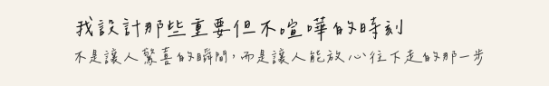

  <picture>
    <source media="(prefers-color-scheme: dark)" srcset="assets/hero-dark.png">
    
  </picture>

<h3 align="center">Evelyn Wu · 吳緗穎 — Senior Product Designer</h3>

<em>I design the decisions AI can't make.</em>

  &nbsp;
  &nbsp;
  

---

I'm a **Product Designer** working on complex products — how information is understood, how decisions get made, and how design brings clarity to ambiguous situations.
Brand: **Eve's Eye** · *See the risk before the click.*
I started out **hand-coding the web** (HTML / CSS / JavaScript) and moved through React / Next.js into product design — so I still like staying close to the build.

## Selected Work

| Project | What it is | Built with |
| :-- | :-- | :-- |
| **[Portfolio → evelynwu.work](https://evelynwu.work)** | UX / product design case studies | Next.js · TypeScript |
| **[incidentAI](https://github.com/wuning/incidentAI)** · [live ↗](https://wuning.github.io/incidentAI/) | Incident-management dashboard with real-time charts | React · Vite · Recharts |
| **[evelynwu.design](https://github.com/wuning/evelynwu.design)** | Portfolio focused on blockchain & security UX | Next.js · TypeScript |
| **[crypto-landing-2019](https://github.com/wuning/crypto-landing-2019)** · [live ↗](https://wuning.github.io/crypto-landing-2019/) | An early hand-coded landing page (2019) | HTML · CSS · jQuery |

## Journey

| Year | Milestone |
| :-- | :-- |
| 2010–2015 | BFA, New Media Art — Taipei National University of the Arts |
| 2018 | UI Developer @ **IBM** — internal CRM for a major bank |
| 2019–2021 | UI/UX Designer @ **BitoEX / BitoPro** — crypto exchange · *BitoDebt: +34% conversion* |
| 2021–2023 | UX → Product Designer @ **ThunderCore** — Layer-1 blockchain |
| 2024 | Senior Product Designer @ **ExistLive** — US, fully remote |
| Now | Product Designer — designing the decisions AI can't make |

## Toolbox

  
  
  
  
  
  
  
  

